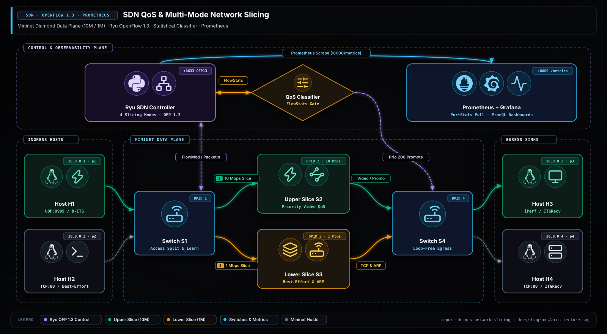

# SDN QoS & Multi-Mode Network Slicing Platform

A Software-Defined Networking (SDN) experimental suite implementing **Topology Slicing**, **Service-Based QoS Slicing**, **Prometheus/Grafana Telemetry**, and **Statistical Adaptive Flow Classification** over a dual-path OpenFlow 1.3 diamond topology in **Mininet** and **Ryu**.

> **Academic Context:** Developed for the *Network and Cloud Infrastructures* course (Prof. Giorgio Ventre, A.Y. 2024/2025) at the University of Naples Federico II (DIETI) by **Giuseppe Ruggiero** (`M63001719`) and **Filomena Vigliotti** (`M63001734`).

---

## Architecture Overview



The emulated data plane builds a 4-switch (`s1`–`s4`), 4-host (`h1`–`h4`) diamond topology separating two bandwidth-constrained paths:

| Path / Slice | Switch Route | Link Bandwidth (`TCLink`) | Primary Role |
| --- | --- | --- | --- |
| **Upper Slice (Priority QoS)** | `S1 (p3) <-> S2 (p1,p2) <-> S4 (p1)` | **10 Mbps** | Priority video/streaming flows (`UDP:9999` or statistically promoted flows) |
| **Lower Slice (Best-Effort)** | `S1 (p4) <-> S3 (p1,p2) <-> S4 (p2)` | **1 Mbps** | Best-effort data (`TCP:80`), reactive L2 learning, and ARP discovery |

---

## Key Capabilities & Controller Modes

1. **`controllers/slicing_controller.py` — Topology Slicing (`RyuSlicing`)**:
   - Enforces strict hard-isolation between pairs `H1 <-> H3` (Upper Slice `S2`) and `H2 <-> H4` (Lower Slice `S3`).
   - Proactive OpenFlow 1.3 `IPv4` rules (priority `100`) + `ARP Proxy` rules (priority `150`) + explicit catch-all `IPv4` drop rule (priority `1`).
2. **`controllers/service_controller.py` — Service-Based QoS Slicing (`RyuController`)**:
   - Enables full connectivity (`h1`–`h4`) across the network while pinning `UDP:9999` streaming traffic onto the **10 Mbps Upper Slice (`S2`)** (priority `100`).
   - Routes generic traffic over the **1 Mbps Lower Slice (`S3`)** with loop-free controlled broadcast confinement (`S1`/`S4` flood strictly toward local hosts and `S3`, never across both slices simultaneously).
3. **`controllers/dashboard_controller.py` — Telemetry & Monitoring (`DashboardController`)**:
   - Combines service-based QoS slicing with periodic `OFPPortStatsRequest` polling (`5 s` interval) and an HTTP Prometheus exporter on `:8000/metrics`.
4. **`controllers/traffic_controller.py` — Statistical Adaptive QoS (`TrafficController`)**:
   - Polls `OFPFlowStats` and `OFPPortStats` every `2 s` (`POLL_INTERVAL`), evaluating active non-static flows against empirical streaming thresholds (`avg_pkt >= 100 B`, `pps >= 1`, `bps >= 10 kbps`, minimum `0.25 s` window).
   - Dynamically promotes high-rate dynamic flows to priority `200` across the **10 Mbps Upper Slice (`S2`)** using loop-free egress resolution.

---

## Code Audit & Security/Reliability Hardening

The repository includes an engineering hardening pass over the baseline academic prototype:

- **Eliminated `S4 <-> S2` Routing Loop (`controllers/traffic_controller.py` / `common/openflow_utils.py`)**: Replaced unconditional `dpid == 4 -> to_s2` adaptive flow promotion with directional `resolve_adaptive_out_port(...)`, preventing packets arriving from `S2` from looping back onto `S2`.
- **Fixed Flow Bitrate Spike & Rule Re-Evaluation**: Included `stat.duration_nsec` alongside `stat.duration_sec` with a `0.25 s` minimum sample floor (eliminating newborn `1e-6 s` division spikes), and filtered out priority-`0` table-miss and static/promoted flows (`priority >= 200`).
- **Fixed OpenFlow 1.3 `buffer_id` Handling**: Properly distinguishes `OFP_NO_BUFFER` (`0xFFFFFFFF`) from buffered packets in `OFPFlowMod` and `OFPPacketOut` (`data=None` when buffered).
- **Fixed Handshake Disconnection Race**: Restricted `_state_change_handler` cleanup strictly to `DEAD_DISPATCHER` instead of clearing maps on `CONFIG_DISPATCHER`.
- **Thread-Safe Prometheus Exporter (`common/metrics_server.py`)**: Added `MetricsStore` with `threading.Lock`, Prometheus label value escaping, `allow_reuse_address`, `BrokenPipeError` handling, and safe loopback default bind (`PROMETHEUS_HOST=127.0.0.1`, overridable via `.env`).
- **Deduplicated Shared OpenFlow Logic**: Consolidated repeated `add_flow`, `OFPPacketOut`, reactive L2 learning, and flood-port selection into `common/openflow_utils.py`.

---

## Repository Structure

```text
sdn-qos-network-slicing/
├── common/
│   ├── metrics_server.py        # Thread-safe Prometheus /metrics HTTP exporter
│   └── openflow_utils.py        # Shared OpenFlow 1.3 rules, PacketOut, and QoS classifier
├── controllers/
│   ├── slicing_controller.py    # Mode 1: Topology isolation (H1<->H3 / H2<->H4)
│   ├── service_controller.py    # Mode 2: Service QoS slicing (UDP:9999 -> Upper 10M)
│   ├── dashboard_controller.py  # Mode 3: Service slicing + Prometheus telemetry
│   └── traffic_controller.py    # Mode 4: Statistical D-ITG flow classification + slicing
├── topology/
│   ├── topology.py              # Mininet 4-switch diamond topology (TCLink 10M / 1M)
│   └── traffic_generation.itg   # D-ITG concurrent UDP:9999 & TCP:80 workload profile
├── tests/
│   └── test_sdn_controllers.py  # Unit tests (mocked Ryu datapaths, HTTP metrics, loop checks)
├── docs/diagrams/
│   ├── architecture.svg
│   └── architecture.png
├── .env.example
└── requirements.txt
```

---

## Setup & Execution (Mininet / Ubuntu Environment)

> Note: Mininet (`OVSKernelSwitch`, `TCLink`) and Ryu require a Linux host/VM with Open vSwitch installed. Unit tests in `tests/` run cross-platform using stubbed OpenFlow primitives.

1. **Start one of the Ryu controllers (Terminal 1):**

```bash
ryu-manager controllers/traffic_controller.py
# Or: slicing_controller.py / service_controller.py / dashboard_controller.py
```

2. **Launch the Mininet dual-slice topology (Terminal 2):**

```bash
sudo python3 topology/topology.py
```

3. **Run connectivity and `iperf` / `D-ITG` experiments from the Mininet CLI:**

```bash
mininet> pingall
mininet> h3 iperf -s -u -p 9999 &
mininet> h1 iperf -c 10.0.0.3 -b 15M -u -p 9999 -t 180
mininet> h4 iperf -s -p 80 &
mininet> h2 iperf -c 10.0.0.4 -b 5M -p 80 -t 180
```

Or replay the bundled `D-ITG` workload profile (`topology/traffic_generation.itg`):

```bash
mininet> h3 ITGRecv &
mininet> h4 ITGRecv &
mininet> h1 ITGSend topology/traffic_generation.itg
```

4. **Grafana / Prometheus PromQL Queries (port `8000/metrics`):**

```promql
# Upper Slice throughput (S1 port 3 -> S2, bps)
(rate(ofp_port_tx_bytes_total{dpid="1", port="3"}[15s]) * 8)

# Lower Slice throughput (S1 port 4 -> S3, bps)
(rate(ofp_port_tx_bytes_total{dpid="1", port="4"}[15s]) * 8)
```

5. **Run unit tests locally:**

```bash
python -m unittest discover -s tests -v
```

---

## Verified Experimental Benchmarks (Mininet + Ryu)

| Experiment / Test Case | Observed Outcome |
| --- | --- |
| **Topology Slicing `pingall`** (`slicing_controller`) | `66% dropped (4/12 received)` — strict isolation holds (`H1 <-> H3` and `H2 <-> H4` only) |
| **Service Slicing `pingall`** (`service_controller`) | `0% dropped (12/12 received)` — full mesh reachability restored over Lower Slice |
| **Priority Video `iperf` (`h1 -> h3`, UDP `:9999`, `60 s`)** | **`9.35 Mbits/sec`**, jitter `5.010 ms`, `0 / 47,796 (0%)` datagram loss on 10 Mbps Upper Slice |
| **Best-Effort `iperf` (`h2 -> h4`, TCP `:80`, `84.26 s`)** | **`958 Kbits/sec`** bounded cleanly to the 1 Mbps Lower Slice (`S3`) |
| **D-ITG Concurrent Workload (`120 s`)** | Sustained `UDP:9999` (`-C 1293 -c 1450` pkt/s/B) on `S2` + `TCP:80` (`-C 488 -c 512` pkt/s/B) classified and isolated from saturating priority traffic |
